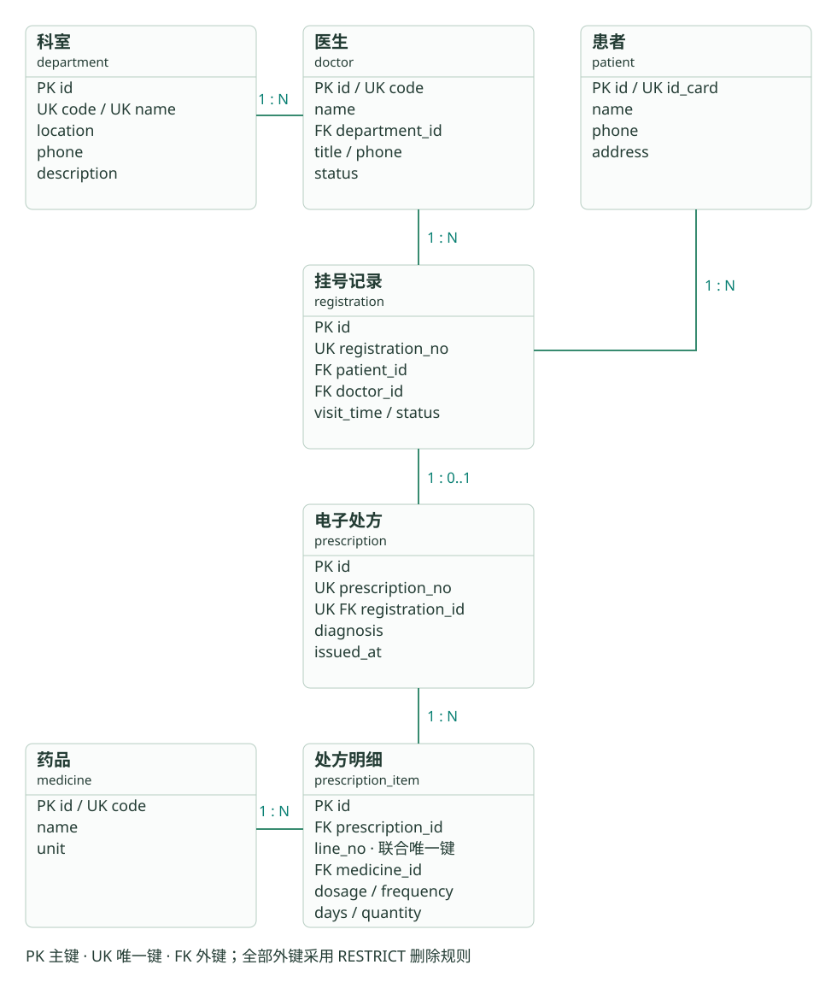

# 数据库模型

数据库为medical_system，字符集utf8mb4，存储引擎InnoDB，建表脚本位于sql/schema.sql。

| 表 | 主键与候选键 | 关联与职责 |
| --- | --- | --- |
| department | id；code和name分别唯一 | 科室资料、地点与联系方式 |
| doctor | id；code唯一 | department_id外键指向科室 |
| patient | id；id_card唯一 | 患者姓名、证件、电话和地址 |
| doctor_schedule | id；doctor_id+visit_date+session联合唯一 | 医生时段、容量、余号与开放状态 |
| registration | id；registration_no唯一 | patient_id、doctor_id关联就诊双方；schedule_id关联排班；计算列active_patient_id与排班联合唯一 |
| prescription | id；prescription_no、registration_id分别唯一 | 关联一次挂号记录及其诊断 |
| medicine | id；code唯一 | 药品名称、单位与非负库存 |
| prescription_item | id；prescription_id+line_no联合唯一 | 关联处方与药品，保存用量、频次、天数和数量 |

## 范式与一致性

每个字段保存单值，处方药品通过明细行表达，不使用逗号拼接多药品列表。非键属性完整依赖本表候选键，处方明细由联合候选键标识行号。

医生只保存科室外键，不冗余保存科室名称。处方通过挂号记录确定医生和患者，不重复保存二者姓名或外键；药品名称、单位集中在药品表。身份证可推导的出生日期不再作为患者字段重复保存。这些设计避免非键属性间的传递依赖，满足第三范式。

主键、必填、唯一、CHECK和外键共同约束数据。所有外键采用RESTRICT删除规则，防止删除仍被引用的记录。挂号时间组合索引支持按患者或医生查询，医生的科室/状态索引支持组合检索。

## 查询与校验

查询使用LambdaQueryWrapper和分页拦截器，字段由服务端固定，用户输入仅作为绑定参数传递。没有客户端可控的SQL片段或排序表达式。

手机号按11位格式校验；身份证按18位结构、真实日历日期、非未来出生日期、顺序码及校验码验证。它用于格式与一致性检查，不表示完成了真实身份认证。应用校验返回400，数据库唯一或外键冲突返回409。

## 初始化与生成

sql/schema.sql仅创建不存在的对象，不删除既有数据库或数据。后续结构变化应另写迁移脚本。sql/sample-data.sql是可选的合成开发数据，不适用于真实诊疗。

执行scripts/generate-persistence.ps1可从真实表元数据生成实体、Mapper及XML；默认保留已有源码。使用-Verify在独立target目录生成24个文件，不影响当前代码。

## 排班与库存迁移

sql/migrations/002_booking_inventory.sql添加排班表、挂号排班关联、有效预约唯一保护与药品stock。scripts/migrate-database.ps1检查已有列和约束，允许中断后重试。MySQL DDL会隐式提交，升级前应自行备份；已完成的步骤不会被重置。

旧挂号记录保留schedule_id=NULL，历史处方不追溯扣库存。新挂号全部关联排班。取消记录的active_patient_id为NULL，同一患者可取消后重新预约；BOOKED和COMPLETED均继续占用原排班名额。数据库计算列仅用于约束，不作为客户端或实体可编辑字段。

排班满足0≤remaining≤capacity，库存stock≥0。业务层同步维护remaining=capacity−有效预约数。容量不得低于已占用数，取消幂等、只归还一次。prescription.registration_id唯一，一次挂号最多一张处方。
