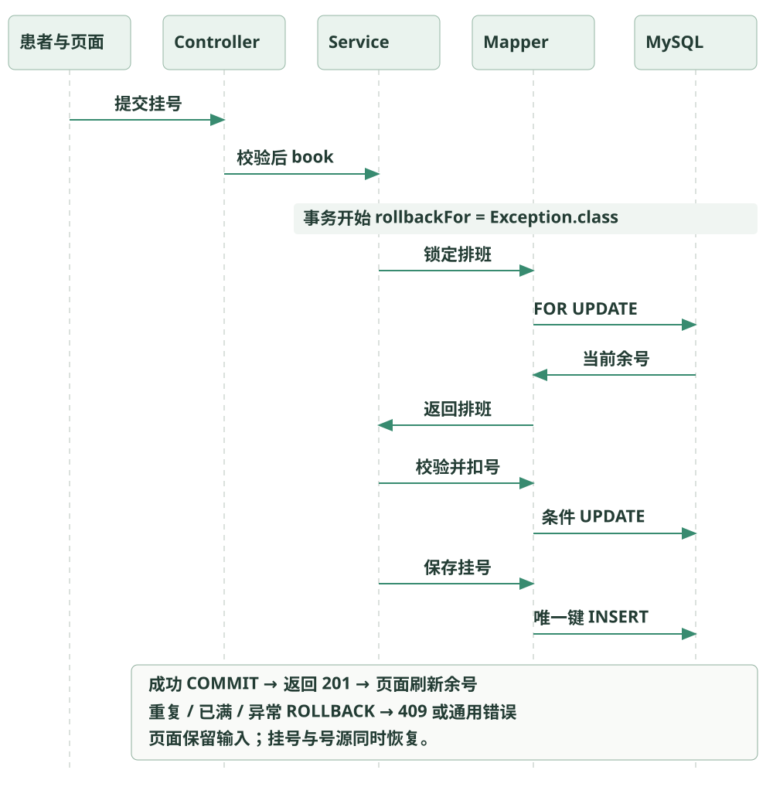
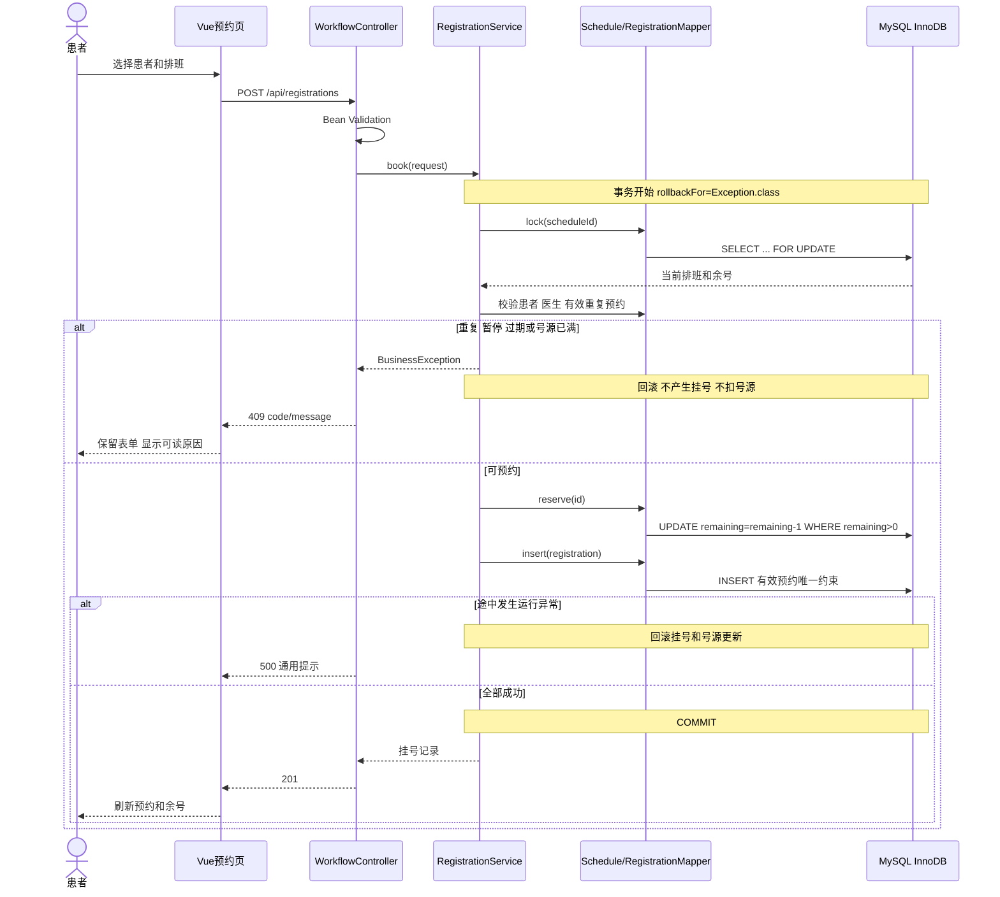
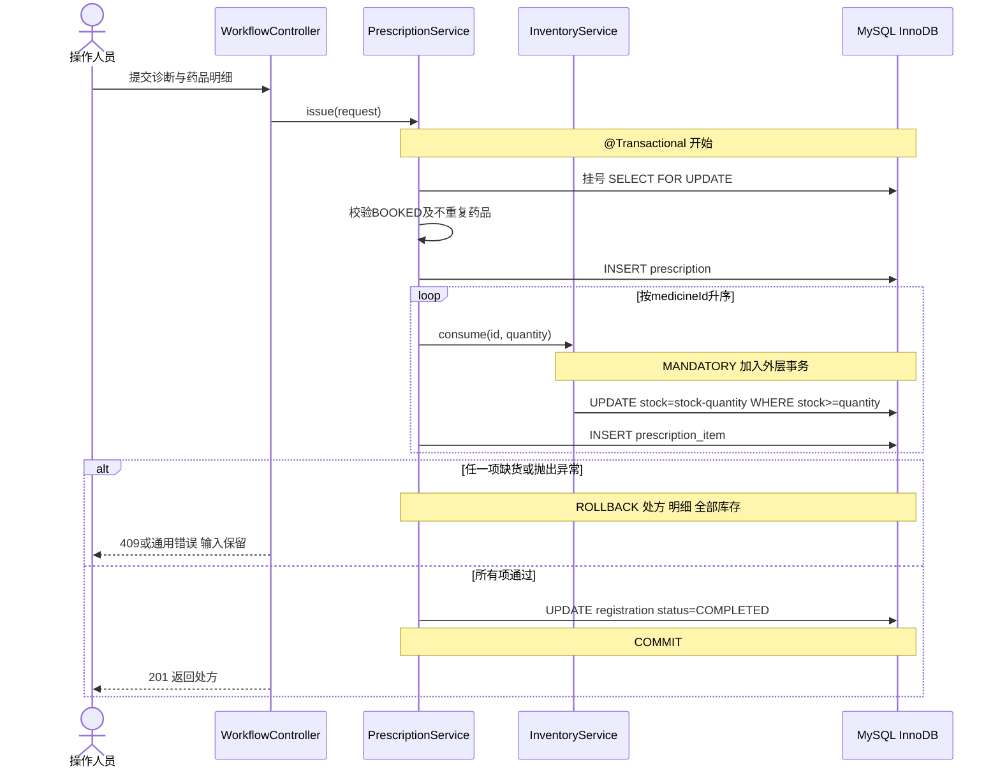

# 预约与处方流程

Controller仅处理输入验证和HTTP响应，ScheduleService管理排班容量，RegistrationService协调挂号与取消，PrescriptionService编排处方，InventoryService封装库存条件扣减。Mapper负责持久化，WorkflowQueryService负责绑定参数的分页关联查询。

## 挂号调用时序

## 处方事务

挂号事务与开方事务分别提交。开方失败保留之前成功的预约，不退回其号源；可以修正药品数量后重试。取消预约按“排班→挂号”的顺序加锁，重复取消不再次归还。开方只锁挂号与药品，不反向锁排班；多药品按ID顺序扣库存。取消与开方竞争由挂号行锁决定先后，最终只能是已取消且无处方，或已完成且库存已扣。

## 真实数据库验证

运行mvn.cmd test -Dtransaction.check=true，启用WorkflowTransactionTests。测试不使用内存库，也不对测试方法添加@Transactional；每个服务的提交或回滚独立可见。

- 正常预约、取消、重复取消和取消后重新预约。
- 正常开方、再次开方与已完成后取消拦截。
- 第二个药品不足，验证第一个药品库存、处方头和已有明细同时回滚。
- 使用Mockito Spy在真实号源更新后和真实库存更新后抛出异常；只在测试中注入，不向HTTP接口暴露失败开关。
- 最后一个号源并发、同一患者重复并发、同一库存并发、取消与开方并发。
- 容量低于占用数、停诊、暂停、过期及重复药品。

样例仅使用合成记录；默认测试运行14项无需真实库的测试，显式启用后共26项。测试清理仅针对本次创建的记录。真实接口回归scripts/workflow-regression.py需要已启动服务和迁移完成的数据库。

设计依据：[Spring事务回滚规则](https://docs.spring.io/spring-framework/reference/data-access/transaction/declarative/rolling-back.html)、[MySQL锁定读](https://dev.mysql.com/doc/refman/8.0/en/innodb-locking-reads.html)。使用事务代理的公开方法和显式rollbackFor，避免自调用绕开事务；库存服务要求已存在事务。
